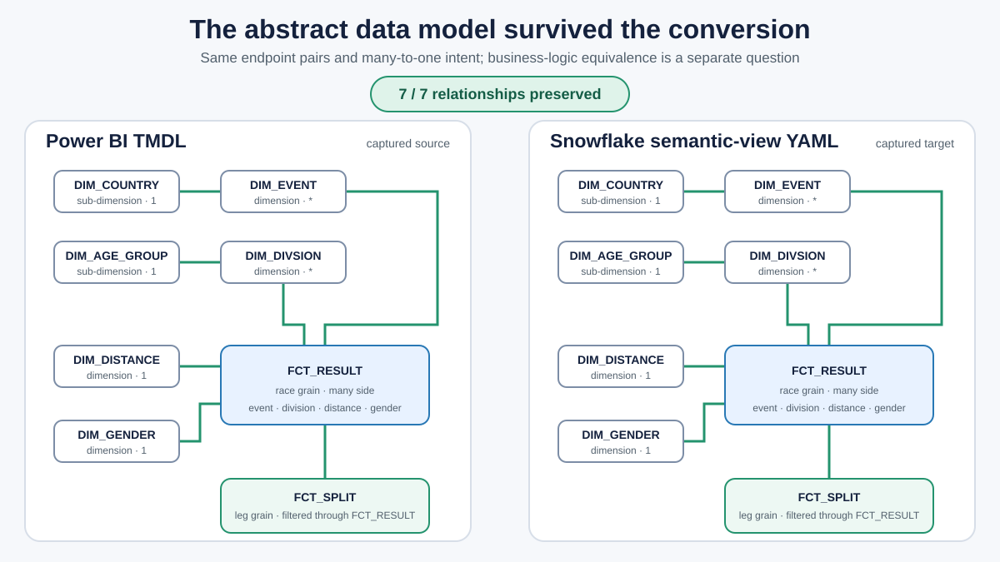
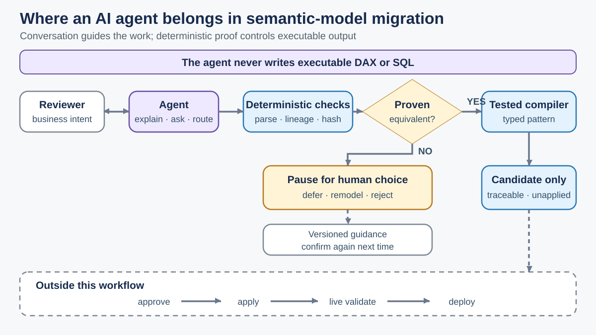

# Power BI Semantic Assurance — conversion evidence and governed review

**Can semantic-model conversion preserve business meaning, not just model structure?**

A public, offline proof of concept for auditing a captured Power BI-to-Snowflake conversion and demonstrating a review-controlled alternative. Deterministic code inventories metrics, checks supported semantics and records evidence; an agent-guided interface proposes next steps without independently authoring accepted DAX or SQL.

**Captured finding:** Of **46 Power BI measures**, **21** were emitted as Snowflake metrics and **25** were omitted. Review classified **four** translations as confirmed incorrect and **four** as potentially incorrect. All **seven reviewed relationship endpoint pairs** matched. **Numerical runtime equivalence was not tested**; this is not a general converter benchmark.

**Start here:** [Run the offline demo](#five-minute-quickstart) · [Evidence and claims](docs/EVIDENCE.md) · [Known limitations](docs/LIMITATIONS.md) · [Review workflow](docs/images/agent-review-flow.svg)

**Related work:** [Analytical AI agent evaluation](https://github.com/JanNeoV/ai-agent-evaluation-lab) · [Technical articles](https://medium.com/@jan.busse)

**Cross-platform lab:** [Semantic Interoperability & Correctness Lab](labs/semantic_interop/showcase/QUICKSTART.md)
— reproduce three experiments through Apache Ossie with MetricFlow and Power BI.

## Five-minute quickstart

Use Python 3.10 or newer. No Snowflake, Power BI, OpenAI, or other cloud
credentials are required.

```text
python -m pip install -e ".[dev]"
python semantic_poc/run_pbi_trial_v2_audit.py --check --json
python semantic_poc/run_demo.py --clean --check
python semantic_poc/run_agent_guided_conversion_demo.py --clean --check
python semantic_poc/run_end_to_end_demo.py --clean --check
```

For a concise narrated sequence:

```text
python demo/run_public_demo.py
```

CI uses `python demo/run_public_demo.py --check`, which removes presentation
pauses and remains fully offline.

## What each command proves

1. The captured `pbi_trial` audit inventories 46 Power BI measures, 21 emitted
   Snowflake metrics, 25 omissions, four confirmed mistranslations, and four
   potentially incorrect translations. All seven reviewed relationship
   endpoints matched. Runtime equivalence is `NOT_AVAILABLE`.
2. The separate `B_SEMANTIC_TRAPS` fixture demonstrates an offline,
   deterministic workflow that blocks unsafe output pending review.
3. The agent-guided demonstration uses a clearly labeled scripted provider.
   The agent selects bounded tools and improves the review interaction;
   deterministic code remains the parser, compiler, and validator.
4. The end-to-end fixture records a human decision, keeps accepted review
   memory confirmation-required, regenerates two target candidates, and reports
   zero unexpected cross-target drift. It does not deploy anything.

Counts from the captured 46-measure audit must not be combined with counts from
the later synthetic fixtures.

## Semantic Interoperability & Correctness Lab

**Can the same business metrics survive conversion between MetricFlow, Power BI
and Databricks using Apache Ossie?**

Apache Ossie is an open semantic interchange format with platform converters.
MetricFlow, Power BI and Databricks have their own metric definitions and execution
engines; Ossie exchanges model descriptions between them. A semantic model carries
more than a metric name: aggregation, eligible rows, relationships, date roles,
filter context and dependencies determine the business answer.

The lab uses **12 sessions and six orders**, with two headline metrics:

| Metric | Expected overall result |
|---|---:|
| Conversion Rate | **40%** |
| Paid Revenue | **390 EUR** |

Direct converts at **50%** (3/6); Indirect at **25%** (1/4). Overall is **4/10 = 40%**,
not the unweighted average, 37.5%. Expanding the revenue filter to include the
existing refunded order changes **390 to 440 EUR**; Conversion Rate stays **40%**.
These are [executed MetricFlow/DuckDB source results](labs/semantic_interop/results/task05-minimal/metricflow/include-refunded/source/execution.json).

Successful file conversion does not guarantee the same calculation. The
[nine investigated paths](labs/semantic_interop/showcase/RESULTS.md) produced
eight outputs and one converter failure. Two native round trips preserve inspected
definitions; six paths have static semantic mismatches. **No unchanged conversion
has a numerically verified target result.** Power BI and Databricks runtime execution
remains unverified; returned MetricFlow models stop at missing configuration.

Start with the three-experiment quickstart, then explore the supporting evidence:

1. [Three-experiment quickstart](labs/semantic_interop/showcase/QUICKSTART.md)
2. [Offline installation and execution](labs/semantic_interop/README.md#offline-quickstart)
3. [Hands-on interoperability tutorial](labs/semantic_interop/showcase/TUTORIAL.md)
4. [Power BI example and manual Desktop setup](labs/semantic_interop/showcase/TUTORIAL.md#exercise-b-power-bi-change-the-default-kpi) — TMSL candidate **NOT_VERIFIED**
5. [Databricks continuation guide for Charlotte](labs/semantic_interop/showcase/DATABRICKS_HANDOFF.md)
6. [Verified results and research limitations](labs/semantic_interop/showcase/RESULTS.md)
7. [Demo acceptance and platform coverage](labs/semantic_interop/showcase/ACCEPTANCE.md)

The lab is separate from the captured Power BI/Snowflake assurance project above.
Historical Task 02 results use a different fixture and remain separately reported
in the [evidence guide](labs/semantic_interop/showcase/RESULTS.md#historical-evidence).

## What converted well



The captured Snowflake YAML preserves the seven endpoint pairs in the Power BI
TMDL, including the normalized country/event and age-group/division chains and
the result-to-split path. This is a topology claim, not complete model or
runtime equivalence.

For ongoing maintenance, the canonical source is
`models/semantic/triathlon_semantic.yml`. Power BI TMDL and Snowflake YAML are
inspected or generated representations, not independent sources of truth.
Unsupported or ambiguous semantics stop at `MANUAL_REVIEW_REQUIRED`.

The offline guided demo now pauses on a deterministic finding and resumes only
with an offered `answer_ref`. It explicitly blocks filter-state logic such as
`ISCROSSFILTERED`, visual-scope logic such as `ISINSCOPE`, inactive
`USERELATIONSHIP` behavior, and measures that depend transitively on those
constructs.
The checked `target/semantic_manifest.json` is a compiled, reproducible input
used by the proposal demonstrations; it is not a second authoring source.

## Agent governance



The agent is the conversational interface, not the semantic compiler. It can
explain evidence, route proposal-only tools, and pause for a structured human
choice. Deterministic code alone parses expressions, resolves dependencies,
binds evidence to hashes, and emits candidate definitions. A candidate remains
unapplied; approval, application, live validation, and deployment stay outside
the demonstrated workflow.

## Evidence and boundaries

- [Evidence and claim map](docs/EVIDENCE.md)
- [Limitations](docs/LIMITATIONS.md)
- [Live-demo script](docs/DEMO.md)
- [Agent-governance flow](docs/images/agent-review-flow.svg)
- [Direct relationship comparison](docs/article-assets/relationship-comparison.md)
- [Captured conversion funnel](docs/images/conversion-funnel.svg)
- [Security policy](SECURITY.md)
- [Public export provenance](PUBLIC_PROVENANCE.json)

The checked `.pbit` in this public repository is a deterministic sanitized
projection of the private source artifact: its account, warehouse, database,
schema, and `SecurityBindings` content were removed or replaced. The portable
TMDL fixture is the audit input. The captured Snowflake YAML is preserved
unchanged because the findings are hash-bound to that output.

## Safety

All public demonstrations are local and proposal-only. They do not contact
Snowflake, Power BI Service, OpenAI, or GitHub; do not approve or apply a
semantic change; do not modify the source Power BI definition; and do not
deploy. Review memory is governed, versioned guidance that always requires
fresh confirmation. It is not model training.

This repository is licensed under Apache-2.0. See [LICENSE](LICENSE) and the
[third-party dependency notices](THIRD_PARTY_NOTICES.md).
