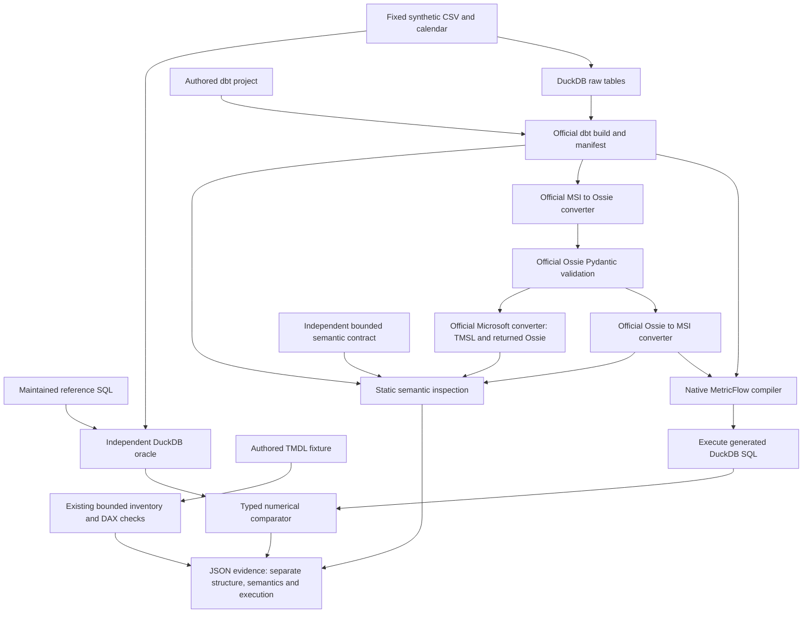

# Architecture

The numerical oracle reads raw tables in a separate in-memory connection. Native
models and queries use a generated disk database with the same typed fixture data.
Neither the oracle nor the expected semantic contract comes from converter output.

The returned MSI manifest is used unchanged. Its compiler initialization currently
fails; the graph describes an attempted path, not a successful round-trip execution.
Microsoft output is inspected as metadata. TOM and a DAX execution engine are absent.

The lab is a separately locked package inside the existing repository. The relative
editable parent dependency reuses its static inspection implementation. Generated
profiles, target directories, databases, logs and environments stay in `.tmp`.
The original captured audit and its provenance manifest remain intact.
