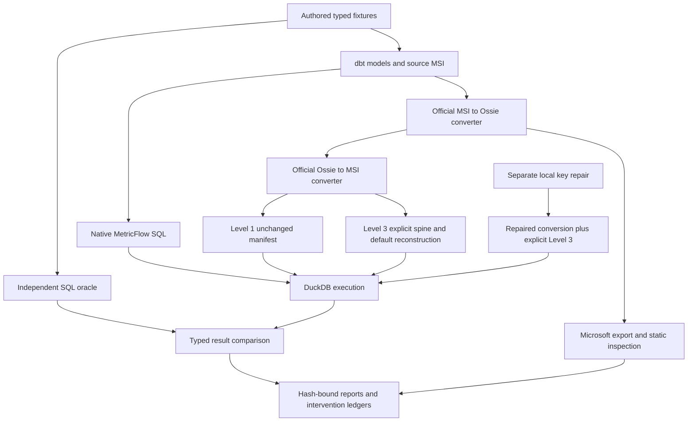

# Your Semantic Models Compile. But Do They Mean the Same Thing? Testing Apache Ossie, MetricFlow and Power BI

*Technical article draft. Research snapshot: 2026-10-17. Not published.*

Moving a metric between analytics tools should preserve more than its name. Revenue needs the same rows, aggregation,
time interpretation and relationships. A ratio needs the same numerator and denominator, including their filters.
Those requirements become especially important when an AI assistant chooses metrics automatically: a syntactically
valid definition can appear authoritative even when its context has changed.

This investigation tests a small, synthetic conversion pipeline rather than making a general claim about Apache Ossie.
The central result is precise: an unmodified MetricFlow-to-Ossie-to-MetricFlow conversion does not execute in the pinned
environment. A focused entity-key repair, combined with explicitly reconstructed temporal configuration, makes
**11 of 14 query cases execute and match an independent DuckDB oracle**. Three cases remain blocked. The intervention
does not establish a lossless round trip, and none of the Power BI results establish DAX numerical equivalence.

## What was actually tested

The benchmark uses authored shop data, dbt semantic definitions, SQL reference queries and a bounded semantic contract.
Its eight business queries cover revenue, order count, average order value, category revenue, daily revenue,
completed-order revenue, completed-revenue share and purchasing customers. Six additional cases exercise empty
results, a zero denominator and a half-open year boundary. Decimal amounts, missing category membership and
distinct counting are intentional parts of the fixture.

The runtime is Python 3.12, MetricFlow 0.213.0, dbt-metricflow 0.15.0, dbt Core 1.12.6, dbt-duckdb 1.11.0 and DuckDB 1.5.6.
Ossie is pinned to `6ebc5e5612467dac405985f44ea078b39c891bee`. Current upstream was independently installed at
`ef91cb61092c60f4b918016a81cfdbe483e113bc`; its intervening changes concern NVIDIA, not these converters.
No baseline dependencies were upgraded.

The oracle reads typed raw tables through independently authored SQL. It does not derive expected answers from
converted definitions. MetricFlow generates the candidate SQL, which DuckDB executes. The comparator preserves
duplicate multiplicity, matches named dimensions, compares integers and decimals exactly, distinguishes NULL from
zero, and applies the established tolerance to floating-point results. Successful parsing is never substituted for execution.



The arrows represent attempted paths, not universal execution success. The original milestone was first reproduced:
26 lab tests and 153 repository tests passed, with one skip. Two offline-guarded benchmark reports were byte-identical
to historical evidence. Its 52 recorded input hashes and 36 artifact hashes matched. Because the milestone was still
untracked in Git, its files were archived before implementation rather than treating the commit ID as sufficient provenance.

## Native execution establishes the reference boundary

All 14 native MetricFlow cases execute and match the oracle. On this fixture, total revenue is 265.30, completed revenue
is 195.30, order count is 8 and purchasing customers is 5. Average order value is 33.1625. The zero-share case returns
NULL; empty sums and empty distinct counts retain their different behavior. These figures are fixture observations,
not estimates of production correctness.

Ten deliberate controls remain detected, including six numerical mismatches. Their purpose is to test whether the
benchmark notices wrong grain, fanout, altered filters or arithmetic. These injected errors must not be described as
upstream converter defects. Conversely, an upstream query that never executes cannot be called a numerical mismatch.

## The first failure was configuration; it was not the last failure

The source manifest contains one time-spine entry. The returned manifest contains none because the return converter
constructs an empty project configuration. Pydantic accepts that representation, but MetricFlow's lookup requires a
modern or legacy time spine before compilation. The calendar table exists; its runtime metadata has disappeared.

This distinction matters. Adding the same external runtime setting through a documented interface would be a legitimate
Level 2 experiment. The pinned lookup API has no independent spine argument. Copying the source entry into the returned
manifest changes the artifact and is therefore explicitly Level 3. The untouched output remains in the evidence.

Restoring the spine exposes a second failure: primary entities are missing. Restoring temporal defaults does not repair
those entities. Once the entity-key converter defect is fixed, the spine-only lane exposes the missing aggregation time
default. Only the repaired conversion plus both recorded temporal interventions reaches the 11 successful executions.
The sequence prevents a later fix from erasing evidence about earlier blockers.

## A small naming mismatch affects two consumers

Consider a source entity named `order` whose physical expression is `order_id`. The exporter creates an Ossie field
named `order`, but places `order_id` in the key. The reverse converter classifies fields by name, so it does not recognize
the entity. Relationships contain the same mismatch. The Microsoft exporter skips their unresolved endpoints.

This is already related to upstream PR315 and the name-resolution discussion. The new evidence is a counterexample
to the proposed reverse-side workaround: a count measure can also use the physical expression `order_id`. Matching
all fields by expression then promotes the measure to another primary entity. A passing simple alias test would miss that.

The local candidate instead changes two exporter assignments so keys and relationship endpoints reference the fields
that were actually exported. It leaves physical expressions on those fields. Three focused tests fail before the patch
and pass afterward. The complete dbt suite passes 179 tests and five snapshots. Existing expectations that explicitly
encoded physical identifiers were updated visibly, with the initial failures retained.

The experiment confirms two effects: the returned entities become usable, and Microsoft emits both previously skipped
relationships. It does not fix metric field resolution, temporal configuration, or arbitrary SQL-to-DAX translation.
The output-name change needs maintainer compatibility review, particularly while the related specification clarification
is still open. This is a local candidate, not an upstream acceptance claim.

## Minimize the failure before expanding the repair

Three regression cases were reduced to one metric and one model, then retested with one remaining input row.
The source query must still match its oracle after reduction; preserving any arbitrary error is insufficient.

The compound-aggregate case starts with a valid scalar CASE expression and an MSI SUM aggregation. Ossie contains
`SUM(CASE ...)`. The return converter stores that aggregate as the metric expression while also declaring SUM,
leading MetricFlow to generate a nested aggregate. DuckDB rejects the SQL.

Upstream issue430 and PR437 already address this mechanism. At the pinned PR437 head, the minimized returned query
executes and matches the oracle, and its complete dbt suite passes 185 tests. Reimplementing that repair would add no value.

A separate filtered-metric case still fails under PR437. A MetricFlow dimension reference becomes `item_id__status`
inside SQL without resolving to a physical column. Removing the extra SUM reveals rather than fixes this problem.
The full fixture also assigns the fallback numerator to the wrong semantic model, blocking the category path for
`zero_share`. These layered failures justify separate reproducers and explain why a single passing regression does not
establish whole-pipeline correctness.

## What the Microsoft path does and does not establish

The Microsoft export emits four annotated BLANK measures. Order count encounters an unresolved incoming reference.
The remaining placeholders involve filtered aggregation or ratio expressions beyond the converter's supported subset.
Warnings and original expressions remain inspectable. The entity-key patch repairs relationships but leaves all four
placeholders, a useful demonstration that structural improvement and measure translation are different outcomes.

A separate authored TMSL probe verifies preservation of original DAX, a measure reference, formatting, visibility,
measure placement and relationship endpoints. It also verifies the already-merged repair for issue444: measures on a
calculated host become first-class metrics and return to that host once. That fix was already present in the baseline.

No Power BI engine was installed or used. No DAX interpreter was created. Neither static round-trip preservation nor
optional TOM validation would prove that Power BI evaluates the measures like DuckDB. A future runtime comparison needs
equivalent typed data, refresh, explicit filter context, relationship behavior and independently defined expected answers.

## Reproduce and interpret the evidence

From the repository root, use the existing pinned lab Python:

```text
python labs/semantic_interop/scripts/setup_task02.py
python -m semantic_lab benchmark --check
python labs/semantic_interop/scripts/reproduce_semantic_loss.py compound_aggregate
python labs/semantic_interop/scripts/reproduce_semantic_loss.py metric_filter
```

The setup prints isolated current/repair Python paths. Pass them to `check_task02.py --upstream-python ... --repair-python ...`.
It runs the diagnostics twice under the inherited socket guard, verifies artifact hashes and checks deterministic reports.
Installation and upstream research are networked; benchmark execution is offline. The guard is a Python audit hook,
not an operating-system firewall.

The [generated tables](DIFFERENTIAL_EVALUATION.md) contain the environment/lane counts and per-metric matrix.
The [sealed report](../results/task02/verified-003/report.json) links observations to manifests, SQL, typed results and hashes.
The [compatibility review](../../../docs/UPSTREAM_COMPATIBILITY_REVIEW.md) distinguishes merged fixes, pending work and local findings.

For enterprise BI and AI analytics, the practical lesson is to retain provenance through conversion and to test execution
against independent expectations. Configuration gaps, expressiveness limits, unsupported translations and converter defects
require different responses. A semantic model's validity establishes that a tool can read it; measured agreement establishes
something narrower and more useful about what specific queries mean on specific data.

This benchmark remains synthetic and bounded. Its partial repair is evidence of progress, not proof that Ossie is generally
safe or unsafe. The valuable deliverable is the inspectable chain from source definition to failed conversion, minimized
counterexample, candidate correction and executed result.
