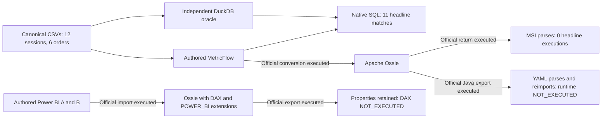

# Two business metrics across semantic platforms

> Runtime update (2026-10-21): the separate [Desktop supplement](../showcase/POWERBI_RUNTIME_VALIDATION.md) verifies the unmodified Power BI core roundtrip. Runtime statements below describe the original static showcase; selector repairs are separate experimental evidence.

This is the supporting technical explanation for the canonical
[`conversion_demo`](../fixtures/conversion_demo/) fixture: 12 sessions, six orders,
and two headline metrics. Counts, AOV, empty groups and other slices remain internal
validation cases. No business data or independent DuckDB oracle has changed.

Start with the executable [five-minute demonstration](../showcase/README.md),
then the independent [hands-on exercises](../showcase/TUTORIAL.md).
Use the [offline quickstart](../README.md#offline-quickstart) for installation,
the [nine-path matrix](../showcase/RESULTS.md) for current results, and
[Charlotte's handoff](../showcase/DATABRICKS_HANDOFF.md) for Databricks continuation.
The detailed grain, loss and provenance explanations below support those guides.

## Frozen business contract

Sessions start on or after **2026-01-01** and before **2026-03-01**; observe orders
strictly before **2026-03-01**. Exclude the bot and internal session. A converted
session has at least one paid order. Recompute converted/eligible distinct session
counts at each requested grain; sum paid EUR amounts attributed to eligible
originating sessions. Never average channel percentages. An eligible cohort with
no paid orders has 0% conversion and NULL revenue; a zero denominator is NULL in
SQL and BLANK in the authored DAX contract. Dates have no timezone component.

| Headline metric | Direct | Indirect | Overall | January session cohort | February session cohort |
|---|---:|---:|---:|---:|---:|
| Conversion Rate | 50% | 25% | 40% | 60% | 20% |
| Paid Revenue (EUR) | 300 | 90 | 390 | 270 | 120 |

These are executed native MetricFlow/DuckDB results, not Power BI or Databricks
observations. Six Direct and four Indirect sessions are eligible; three and one
convert. The cancelled EUR 20 and refunded EUR 50 orders do not qualify. Exact
contract and internal cases remain in [contract.json](../fixtures/conversion_demo/contract.json)
and the [canonical report](../results/task04/metricflow/report.json).

A January 6 session has a paid EUR 80 order on February 1. Both headline metrics
attribute activity to the originating **session month**, so that order belongs to
January's cohort, within the fixed March 1 observation cutoff. Session-cohort
revenue is EUR 270 in January and EUR 120 in February; grouping by order month
instead gives EUR 190 and EUR 200. Both totals are EUR 390, so matching only the
overall total would miss a change in date role. This snapshot gives the cohorts
different follow-up ages and uses whole-order statuses without partial refunds.

## MetricFlow to Ossie and back: unchanged official output

Reproduce with the existing runner; it retains all supporting validation cases:

```powershell
.\.tmp\semantic-lab-venv\Scripts\python.exe labs/semantic_interop/scripts/run_conversion_platforms.py --capture .tmp/task04-metricflow-review
```

The source contains these original definitions (dependencies remain in the full file):

```yaml
- name: conversion_rate
  label: Conversion Rate
  type: ratio
  type_params:
    numerator: converted_sessions
    denominator: eligible_sessions
- name: paid_revenue
  label: Paid Revenue
  type: derived
  type_params:
    expr: paid_revenue_base + 0 * eligible_sessions
    metrics:
    - name: paid_revenue_base
    - name: eligible_sessions
```

The source retains the eligible-session group domain using supported derived
metrics. This authored modeling makes zero-conversion groups visible; it is not a
repair. The [independent SQL oracles](../fixtures/conversion_demo/oracle/) do not
import these expressions. Source cohort and cutoff transformations live in
[`sessions.sql`](../fixtures/conversion_demo/dbt/models/sessions.sql) and
[`orders.sql`](../fixtures/conversion_demo/dbt/models/orders.sql); the generated
Ossie relation names do not embed those transformations.

Actual Ossie expands the dependencies into aggregate SQL text. For example, its
`paid_revenue` expression is:

```sql
SUM(CASE WHEN session__is_eligible = true AND order__order_status = 'paid'
THEN orders.amount_eur END) + 0 * COUNT(DISTINCT CASE
WHEN session__is_eligible = true THEN sessions.session_id END)
```

This is preserved generated text, not executed portable SQL. The
[returned MetricFlow manifest](../results/task04/metricflow/platforms/roundtrip.manifest.json)
changes `paid_revenue` into a simple metric with `agg: sum`, the full aggregate
text in `type_params.expr`, and `semantic_model: sessions`. It rebuilds Conversion Rate
with generated `conversion_rate__numerator` and `conversion_rate__denominator`
helpers. Inspect the original file rather than treating this reconstruction as the
original dependency graph.

Dataset names, physical relation strings, dimension classifications and predicate
text survive. Entity declarations, both default aggregation-time settings, metric
labels and the one time spine disappear. Day granularity and ratio helpers are
reconstructed by converter convention. No metadata is copied back. The return is
Pydantic-parseable, but all **11 headline execution attempts** (31 internal cases)
stop at missing time-spine configuration: **zero execute and no round-trip oracle
comparison is possible**. The official dbt converters report no issues; their
empty issue lists and complete console output remain in
[the summary](../results/task04/metricflow/headline-summary.json) and
[raw diagnostics](../results/task04/metricflow/platforms/integration.json).

## Power BI: core metrics and dynamic SWITCH

Case A starts from the existing authored model and transcribes two public measures
plus their two hidden count dependencies to TMSL/model.bim. Case B adds exactly one
disconnected two-choice KPI Selector and one numeric `Selected KPI` measure. The
[offline runner and evidence](../fixtures/conversion_demo/targets/powerbi/README.md#task-04-official-round-trip)
use the unmodified official Microsoft converter in both directions.

Both cases preserve inspected measure expressions, dependency names, tables,
relationships, cardinality/direction, partitions and filter metadata. They retain
DAX dialect expressions and use `POWER_BI` custom extensions for Power BI metadata.
The warning about shared Power Query expressions/parameters is retained. These
static checks do not establish that DAX compiles, filters propagate numerically,
or a reconstructed model loads in Power BI; TOM and DAX remain `NOT_EXECUTED`.

### SWITCH limitations

`SWITCH(SELECTEDVALUE('KPI Selector'[KPI], "Conversion Rate"), ...)` chooses the
headline metric. Single selections should return that metric; no selection and
multiple selections should default to Conversion Rate. Direct/Indirect filters
must still reach Sessions and Orders, and Conversion Rate must resolve its hidden
measure dependencies. Expected outcomes and separate DAX Query View queries cover
these states. Dynamic format metadata selects `0.0%` or EUR currency while the
measure stays numeric. Visual format rendering is `NOT_EXECUTED`.

DAX text, disconnected selection state, filter context, M partitions and dynamic
format strings are **PRESERVED_VENDOR_SPECIFIC**. They are not portable SQL. A SQL
consumer cannot infer their Power BI behavior from preserved text. Executable
cross-platform translations of this selector and formatting are **UNSUPPORTED**
in this showcase. Runtime verification remains **NOT_EXECUTED**.

## Tiny public comparison

Each column is a separate claim. Parsing validates file shape, not engine validity;
retained text establishes only the stated structural observation.

The single [nine-direction matrix](../showcase/RESULTS.md) covers all investigated
paths. It distinguishes completed conversion, bounded static preservation, native
target execution and numerical oracle agreement. The detailed observations below
are supporting evidence, not a separate pass-rate table.

The Databricks lane built the current official Java adapter separately and passed
its 100 upstream tests. Export with `--source sessions` and re-import both exit 0.
The [unedited YAML](../results/task04/databricks/generated.metric-view.yml) has a
sessions source and an `orders` one-to-many join. Twelve notices include seven
dropped joined-table dimensions and three dropped time-classification flags.
Unresolved `session__is_eligible` and `order__order_status` tokens remain in measure
text. Databricks creation, analyzer validation and numerical execution are
`NOT_EXECUTED`; these static findings do not assert an observed runtime error.
See the [exact capture](../results/task04/databricks/report.json).

The [MetricFlow summary](../results/task04/metricflow/headline-summary.json),
[Power BI findings](../fixtures/conversion_demo/targets/powerbi/README.md#task-04-official-round-trip)
and [Databricks handoff](../showcase/DATABRICKS_HANDOFF.md) bind those claims to actual files.
Vendor-construct classifications are separate from the five claims above:

- **PORTABLE:** dataset/field names, types and relationship endpoints in the
  inspected interchange structures, plus the shared business contract. This is a
  bounded structural classification, without an engine-equivalence claim.
- **PRESERVED_VENDOR_SPECIFIC:** Power BI DAX, filter direction, M partitions and
  dynamic formats via DAX dialect/`POWER_BI` extensions; the Databricks re-import
  retains native `one_to_many` cardinality in a `DATABRICKS` extension.
- **UNSUPPORTED:** the unchanged MSI return omits its source spine/entities/defaults;
  joined-table dimensions and `is_time` flags have no emitted Metric View slot in
  this observed export. This showcase supplies no SQL translation of SWITCH.
- **NOT_EXECUTED:** TOM/Power BI model loading, DAX selection/filter/format behavior,
  Databricks analyzer validation, target numerical results and oracle comparisons.




## Versions and retained research

The baseline uses Apache Ossie core/dbt/Microsoft **0.2.0.dev0**, all installed from
`6ebc5e5612467dac405985f44ea078b39c891bee`, with MetricFlow 0.213.0 and DuckDB 1.5.6.
On October 18, 2026, live upstream main was
`53418ba8a4b8a20951334fdb9d9638aa34b514e3`. The official dbt and Microsoft READMEs
are byte-identical at those SHAs and still document both directions; their package
version strings are also unchanged. Independent Git tree comparisons additionally
confirm that core Python, dbt and Microsoft package directories are identical at
those two SHAs (the version strings alone would not establish this).
[The review](../results/task04/upstream-review/review.json) records official URLs
and source hashes. The baseline, lockfile and upstream checkouts remain unchanged.

Historical Task 02 has a different fixture: 14 native matches, zero unchanged
round-trip executions, and 11 matches only after a separate key repair **plus
explicitly reconstructed temporal configuration**. Those interventions are absent
here. Its [sealed report](../results/task02/verified-003/report.json),
[diagnosis](ROUND_TRIP_DIAGNOSIS.md), and [custody record](TASK02_VALIDATION.md),
as well as all [Task 03 accepted captures](TASK03_VALIDATION.md), remain intact.
Fresh Task 04 validation and the changed-file inventory are linked from that record.
