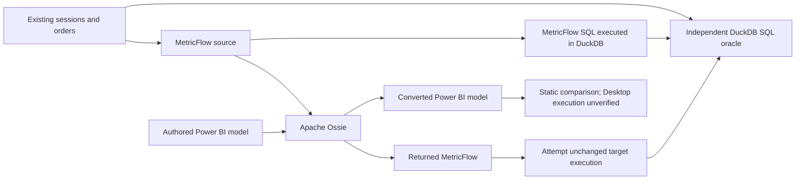

# Three experiments: do converted metrics keep their meaning?

Apache Ossie exchanges semantic model definitions. A successful conversion does
not establish that the receiving engine calculates the same answer.

This demo uses the existing **12 sessions and six orders**. Excluding bot and
internal traffic leaves **10 eligible sessions**, four with a paid order:
**Conversion Rate = 4/10 = 40%**, **Paid Revenue = EUR 390**.
Direct contributes 3/6 conversions and EUR 300; Indirect 1/4 and EUR 90.
Sessions without orders stay in the denominator; averaging channel rates is wrong.

Both metrics use January/February 2026 **session cohorts**, observing orders before
March 1. A February order from a January session belongs to January. See the
[business contract](../fixtures/conversion_demo/contract.json).



## Setup and run

Requires Git, Python **3.12**, and internet for initial installation. The lockfile
pins the adapters; no analytics account, credentials, Java, or Power BI Desktop
is required. Run from the repository root. Installation takes longer than the demo.

macOS/Linux shell:

```sh
git clone --branch main https://github.com/JanNeoV/pbi-osi-converter.git
cd pbi-osi-converter
python3 -m pip install uv==0.12.17
python3 labs/semantic_interop/scripts/setup.py
PY=.tmp/semantic-lab-venv/bin/python
"$PY" labs/semantic_interop/scripts/run_showcase.py --scope three --check --output .tmp/three-demo
```

Windows PowerShell:

```powershell
git clone --branch main https://github.com/JanNeoV/pbi-osi-converter.git
Set-Location pbi-osi-converter
python -m pip install uv==0.12.17
python labs/semantic_interop/scripts/setup.py
$py = '.tmp/semantic-lab-venv/Scripts/python.exe'
& $py labs/semantic_interop/scripts/run_showcase.py --scope three --check --output .tmp/three-demo
```

For an existing checkout, start at installation. Choose a **new output directory**
for each run; the command refuses overwrites. After setup, execution is local and
offline. Open `.tmp/three-demo/report.md` and `report.json`. Relative links in the
Markdown report lead to the exact source, converted output, warnings and comparisons
from your run. `definitions.json` retains metric definitions and dependencies;
`static-comparison.json` retains inspected configuration differences.

`--check` validates the demonstration and evidence, including **31 source matches**
and **five detected injected faults**. Exit 0 does not mean lossless conversion.
The faults are deliberately authored SQL mistakes, separate from upstream behavior.

## 1. MetricFlow → Apache Ossie → MetricFlow

Expected: **conversion PASS; static MISMATCH; target execution BLOCKED;
target oracle agreement BLOCKED**.

The unchanged returned model loses time-spine configuration, entity declarations,
and default aggregation-time dimensions. Actual initialization attempts stop at
the missing spine. No later execution failure or target value is claimed.

Inspect `metricflow/to-ossie/output.ossie.yml`,
`to-metricflow/metricflow/output.manifest.json`, and
`to-metricflow/metricflow/execution.json` in your output directory.
Existing sealed examples: [inventory](../results/task04-showcase/to-metricflow/metricflow/leg.json),
[execution attempts](../results/task04-showcase/to-metricflow/metricflow/execution.json).

## 2. Power BI → Apache Ossie → Power BI

Expected: **conversion PASS; bounded static PASS; target execution NOT_EXECUTED;
target oracle agreement BLOCKED**.

The authored fixture's normalized DAX, relationships, columns, partitions, M and
formatting metadata survive this round trip. That is a model comparison, not a
Power BI Desktop refresh or DAX query. Optional TOM deserialization is also not
runtime execution. The source fixture itself is not Desktop-verified.

Inspect `powerbi/core/source.model.bim`, `powerbi/core/from-ossie/output.model.bim`,
and `powerbi/core/report.json`. Existing sealed
[comparison](../results/task04-showcase/powerbi/core/report.json) and
[manual Desktop exercise](TUTORIAL.md#exercise-b-power-bi-change-the-default-kpi)
describe the boundary.

## 3. MetricFlow → Apache Ossie → Power BI

Expected: **conversion PASS; static MISMATCH; target execution NOT_EXECUTED;
target oracle agreement BLOCKED**.

The converter substitutes annotated `BLANK()` for unsupported expressions,
including both headline measures. Captured warnings also identify a skipped
relationship. Preserved SQL annotations do not calculate a DAX result.

Inspect `to-powerbi/metricflow/output.model.bim`, `warnings.json`, and `report.json`.
Existing sealed [warnings](../results/task04-showcase/to-powerbi/metricflow/warnings.json)
and [converted BIM](../results/task04-showcase/to-powerbi/metricflow/output.model.bim)
show the observed changes. The generated report compares original and converted
definitions directly; it does not infer numerical failure from `BLANK()`.

## Optional: reproduce the Power BI SWITCH selector without Desktop

The standard three-route demo includes the authored Power BI **core** model. The
disconnected `KPI Selector` and the `SWITCH(SELECTEDVALUE(...))` measure are a
**separate Power BI → Ossie → Power BI diagnostic**, not a fourth route and not
an executed DAX result. For an actual editable selector example, follow
[Exercise B3](TUTORIAL.md#b3-export-model-metadata-and-run-power-bi--ossie--power-bi)
using the supplied `baseline.model.bim` and `changed-default.model.bim`.
The exercise supplies Windows PowerShell and macOS/Linux shell commands and
compares both the measure expression and its dynamic-format expression.

The local candidate round trip requires no Power BI credentials. Desktop
validation of selection behavior, channel filtering, and rendered formatting
remains a [separate manual exercise](TUTORIAL.md#b2-add-and-test-the-dynamic-selector).
A passing static comparison must **not** be reported as a working selector in
Power BI Desktop.

## Optional: include refunded revenue

Use a disposable source copy. The existing EUR 50 refund changes source revenue
to **EUR 440**, while Conversion Rate stays **40%**. This exercise changes only
the revenue rule, not the denominator, conversion rule or cohort dates.

POSIX commands (use the `$PY` defined above):

```sh
WORK=.tmp/refund-exercise
HELPER=labs/semantic_interop/showcase/metricflow_task05.py
"$PY" "$HELPER" init --work "$WORK"
"$PY" -m dbt.cli.main build --no-partial-parse --project-dir "$WORK/dbt" --profiles-dir "$WORK/dbt"
"$PY" "$HELPER" execute --work "$WORK" --label before
```

PowerShell equivalents:

```powershell
$work = '.tmp/refund-exercise'
$helper = 'labs/semantic_interop/showcase/metricflow_task05.py'
& $py $helper init --work $work
& $py -m dbt.cli.main build --no-partial-parse --project-dir "$work/dbt" --profiles-dir "$work/dbt"
& $py $helper execute --work $work --label before
```

In `.tmp/refund-exercise/dbt/models/metrics.yml`, under `name: paid_revenue_base`,
replace the **entire two-line filter field**, including its continuation, with:

```yaml
  filter: "{{ Dimension('session__is_eligible') }} = true AND {{ Dimension('order__order_status') }} IN ('paid', 'refunded')"
```

Rebuild, execute the edited source, and inspect its unchanged return through Ossie:

```sh
"$PY" -m dbt.cli.main build --no-partial-parse --project-dir "$WORK/dbt" --profiles-dir "$WORK/dbt"
"$PY" "$HELPER" execute --work "$WORK" --label after --include-refunded
.tmp/semantic-lab-venv/bin/ossie-dbt msi-to-ossie -i "$WORK/dbt/target/semantic_manifest.json" -o "$WORK/after.ossie.yml" --model-name conversion_demo
.tmp/semantic-lab-venv/bin/ossie-dbt ossie-to-msi -i "$WORK/after.ossie.yml" -o "$WORK/after.returned.json"
"$PY" "$HELPER" execute --work "$WORK" --label returned --manifest "$WORK/after.returned.json" --include-refunded
```

```powershell
& $py -m dbt.cli.main build --no-partial-parse --project-dir "$work/dbt" --profiles-dir "$work/dbt"
& $py $helper execute --work $work --label after --include-refunded
& .tmp/semantic-lab-venv/Scripts/ossie-dbt.exe msi-to-ossie -i "$work/dbt/target/semantic_manifest.json" -o "$work/after.ossie.yml" --model-name conversion_demo
& .tmp/semantic-lab-venv/Scripts/ossie-dbt.exe ossie-to-msi -i "$work/after.ossie.yml" -o "$work/after.returned.json"
& $py $helper execute --work $work --label returned --manifest "$work/after.returned.json" --include-refunded
```

`after/execution.json` should contain four true comparisons: overall/channel
revenue becomes 440 / 300 / 140 EUR, while conversion remains 40% / 50% / 25%.
The flag selects the independent refund oracle; the YAML edit changes the source.
`returned/execution.json` records the blocked target, not EUR 440. The helper may
exit 0 while recording blocked queries: read its comparisons. Existing
[before](../results/task05-minimal/metricflow/baseline/source/execution.json),
[after](../results/task05-minimal/metricflow/include-refunded/source/execution.json),
and [target attempt](../results/task05-minimal/metricflow/include-refunded/target/execution.json)
retain this distinction. Start another fresh work directory to reset.

## Troubleshooting and limits

- **All platforms:** use Python 3.12 and the environment's interpreter. Setup needs
  network access; run commands from the repository root. If `uv` is absent from
  PATH, reopen the shell after installation. Do not upgrade the lockfile.
- **macOS/Linux:** executable paths use `bin/`; quote variables as shown. If
  installation fails for your OS/architecture, retain the error and report it;
  compatibility has not been established for every architecture.
- **Windows:** use `& $py`, not `$py` alone. No activation or execution-policy
  change is required. Choose short work paths if a dependency reports path limits.
- **Existing output:** use a fresh `--output` or `--work` path. Do not overwrite
  evidence or repair generated models to obtain a passing run.
- **Missing spine / BLANK():** these are expected observed converter boundaries,
  not installation fixes. Unexpected errors fail demo acceptance.
- **Platform coverage:** Windows was validated locally in the recorded 2026-10-18
  acceptance run. The focused [GitHub Actions run](https://github.com/JanNeoV/pbi-osi-converter/actions/runs/39160283961)
  subsequently passed on **Windows, Ubuntu and macOS** at commit `6f342299`.
  These are CI executions, not fresh manual runs on each platform. See the
  dated [acceptance addendum](ACCEPTANCE.md#addendum--2026-10-19).
- **Separate historical CI failure:** the older full-lab Ubuntu job fails in its
  Task 02 replay environment. That job is not a required merge check; it does not
  negate the passing focused three-experiment CI. See the
  [closeout report](../docs/PUBLICATION_READINESS.md#ci-status-and-merge-policy).

This fixture is a bounded teaching example, not a general equivalence proof.
No converted target has verified numerical agreement. No Power BI Desktop/DAX
runtime is exercised. The Python socket guard used in tests is not an OS firewall.
The [wider nine-path results](RESULTS.md) and [tutorial](TUTORIAL.md) remain available.
